# Last 20% Finishing Skill - Plan

## Goal Capsule

- **Objective:** A strong creative draft (scored about 7 to 9 by the user) becomes a cohesive, restrained, readable finished piece that stays creative, and the user does not have to find and explain each fault themselves.
- **Means:** a new skill, `finishing/`, in this repo, separate from `creativity` (KTD1). Its first test finishes the three phils.app finals (A, B, C).
- **Product authority:** Philip (the user) is the last judge of taste. The skill's judges advise; his approval of the fix list and his final scores decide. Then this plan, then repo conventions (`AGENTS.md`).
- **Stop conditions:** stop and ask if a step would edit an original draft or the live site, commit test runs, or open an extra browser.
- **Execution profile:** one change set on the `creativity-skill` branch line, or a new branch, managed with GitButler. Commit and push only when the user asks. U1 to U5 build the skill. U6 runs the first test and needs the user for one approval and for the final scores.
- **Open blockers:** none.

---

## Product Contract

Product Contract preservation: changed: R13, AE8 — aligned with the user-approved vote rule in KTD5 (undo only on a loss in both orders); AE5 and the Success Criteria open-list wording clarified. No scope change.

### Summary

A panel of seven specialist design editors reviews a draft. Their findings merge into one ranked fix list with the protected details and the grafts from other drafts. The user approves the list once, and the builder fixes it within about one hour per piece. Function checks run after the design fixes, and a fresh blind judge compares before and after. The user gets the finished piece, before/after pictures and a short list of open items.

### Problem Frame

The `creativity` skill ends at a storyboard of three finals. Each final lists what is weak and what was not checked, and leaves that work to the user (`creativity/SKILL.md:137`). In run 3 the user scored the finals 7 to 9, but every one still "goes too far" in places, in his words:

- **Lined paper:** the lines on the lined-paper pieces do not match the text.
- **Dog icon:** the pixel dog looks goofy.
- **Background map:** the tree map behind the trail page looks cheap and low quality.
- **Winding path:** it makes no sense, and a huge empty green space sits at the bottom.
- **Passport style:** EVERYTHING has a passport design.
- **UV lamp:** creative, but it makes the text hard to read.
- **Stamp sheet:** the same mountain icon repeats on every stamp, and each app's own icon is lost.

His summary: "The best designs are ones with constraints." The last 20% is not mostly about whether things work. It is about refining, tightening and finishing the design into a cohesive page that does not go too far, but stays creative and readable.

Today nothing in the repo does this pass. The creativity judge returns at most three gaps (`creativity/agents/scorer.md:68`) and folds execution faults into its taste score (`scorer.md:33`). Its drift goes both ways: about 0.6 too high in run 2, and 1 to 2 points too low in run 3 (`scorer.md:47`). Only one detail is protected between drafts (`creativity/SKILL.md:115`). Good details from replaced directions are lost, for example the "Goodnight, Portland" footer (`creativity/calibration/web/README.md:49`).

### Actors

- A1. **The user (director):** approves the fix list once and gives the final scores.
- A2. **The design editors:** seven independent reviewers, each for one fault kind (R3).
- A3. **The referee:** merges and ranks the editors' findings and settles conflicts (R5).
- A4. **The builder:** makes the fixes on a copy of the draft.
- A5. **The blind judge:** compares before and after without knowing which is which (R12).

### Key Decisions

- **A separate skill, not a new stage of `creativity`.** The user asked for a new skill. It takes any strong draft, including work that `creativity` did not make.
- **Design editing is the main job, and function checks come second.** Governs R3, R10. (session-settled: user-directed — chosen over giving design and function equal weight: the last 20% is mainly about refining the design, not about whether things work.)
- **A panel of seven specialist editors.** Governs R3, R4, R5. (session-settled: user-directed — chosen over one editor with a rulebook, and over a single editor: a panel finds the most faults.)
- **The user approves the list once.** Governs R7. (session-settled: user-approved — chosen over seeing only the end, or keeping or undoing each fix: one checkpoint keeps control without a wait on every fix.)
- **About one hour per piece.** Governs R9. (session-settled: user-approved — chosen over 20 minutes or no limit.)
- **Success means "better and nothing broken".** Governs R14, R15. (session-settled: user-approved — chosen over "my score goes up" alone, or "nothing broken" alone.)
- **The first test finishes A, B and C.** Governs R16. (session-settled: user-approved — chosen over C only, or adding a non-web test now.)
- **Restraint is a finishing goal, not only the absence of faults.** A finish may remove or calm parts of the concept as well as add detail, because "the best designs are ones with constraints".

### Requirements

**Input and safety**

- R1. The skill takes one or more finished drafts in any medium, plus any user words about them (scores, praise, complaints), and works only on copies. The originals and the live work are never changed.
- R2. Before review, the skill writes a protected-details list from the user's praise and the draft's strongest thing. A fix that weakens a protected detail is not allowed. Where a protected detail is also faulty (for example the UV lamp), the fix improves it without removing it.

**The design editor panel**

- R3. Seven independent editors review each draft in parallel. Each one looks only for its own fault kind:
  - the concept is overused (it is everywhere instead of where it earns its place);
  - details do not line up (grids, lines, baselines, edges);
  - the art or imagery looks cheap or low quality;
  - a part has no meaning inside the concept;
  - dead space or poor balance in the composition;
  - an effect hurts readability or clarity;
  - a specific detail was lost (generic repeats where real, specific content was).
- R4. Each finding names where it is, what is wrong, why it matters to the whole piece, and a proposed fix. It includes a capture or an excerpt as evidence.
- R5. A referee merges the findings, removes duplicates, settles conflicts between editors (for example "add detail" against "too much"), and ranks the result by visible impact and fix cost.
- R6. The fix list also offers grafts: strong details from sibling drafts and replaced directions that fit the chosen piece. Each graft must be re-made in the piece's own art direction.

**Approval and fixing**

- R7. The user sees one short, ranked list per piece in plain words: fixes, protected details and offered grafts. They approve, edit or remove items once before any fix is made.
- R8. The builder fixes only the approved items. Each fix is small and can be undone on its own.
- R9. Work on one piece stops after about one hour. Items not done go to the open list.
- R10. After the design fixes, the skill runs function checks under the medium's real conditions of use. For web these are a phone width, a visible tab for motion, links, forms, reduced motion and weight/speed. Failures are fixed or put on the open list.

**Verification and hand-over**

- R11. Each medium names its conditions of use and its function checks. The web set is the first, and the structure must allow other media (for example a story read aloud, or a song on small speakers) without changing the rest of the skill.
- R12. A fresh blind judge, which never saw the fix list or the builder's notes, compares the before and after captures of each piece. It sees them under the same conditions, without labels, twice with the order swapped. It says which version is better and whether anything got worse.
- R13. A fix is undone before hand-over when it makes a protected detail weaker or removes it, or when the blind judge prefers the before version in both orders (KTD5).
- R14. The hand-over for each piece is: the finished piece, before/after pictures of the main fixes, the blind judge's verdict, and a short open list. The open list has each item's severity and why it was not done, including anything that could not be checked here (for example a real phone).
- R15. The user's final scores and words go into the calibration examples, so the editors and the judge learn the user's taste.

**First test**

- R16. The first test finishes the three phils.app finals (A small, B medium, C large). It works in a git-ignored folder and uses only the built-in browser.

### Acceptance Examples

- AE1. **Covers R3, R5.** On page C, the "concept overused" editor reports that the passport style is on almost every section. The referee ranks it high. The fix keeps the passport style for the ID card and the passport section only, and calms the rest.
- AE2. **Covers R3.** On page A, the "details line up" editor reports that the notebook lines do not match the text lines. The fix makes the text sit on the lines.
- AE3. **Covers R2, R3.** On page C, the "readability" editor reports that UV mode makes the text hard to read. The UV lamp is protected, so the fix keeps the lamp and makes the text readable while it is on.
- AE4. **Covers R3.** On page C, the "lost specifics" editor reports that every stamp shows the same mountain icon. The fix gives each stamp its app's own icon or image.
- AE5. **Covers R3.** On page B, the "cheap art" editor reports that the tree map looks low quality, and the "meaning" editor reports that the winding path makes no sense. The referee groups them into one fix group. The "balance" editor reports the empty green space at the bottom as its own item.
- AE6. **Covers R5.** When one editor proposes adding a detail to the footer and another reports that the page already has too many paper forms, the referee keeps one proposal and records why.
- AE7. **Covers R9, R14.** When the hour ends with three approved items not done, the hand-over lists them on the open list with their severity.
- AE8. **Covers R12, R13.** When the blind judge prefers the before version in both orders for a fix, the skill undoes that fix and notes it on the open list. A split verdict keeps the fix and marks it "judge unsure" (KTD5).

### Key Flows

- F1. **Finish one piece.**
  - **Trigger:** the user asks to finish one or more drafts.
  - **Steps:** copy the drafts → protected-details list (R2) → seven editors in parallel (R3, R4) → referee merges, ranks and adds grafts (R5, R6) → the user approves the list (R7) → the builder fixes within the hour (R8, R9) → function checks (R10) → blind judge (R12) → undo regressions (R13) → hand-over (R14).
  - **Ends:** the user scores the result, and the scores go to calibration (R15).

### Success Criteria

- For each of A, B and C, the user prefers the finished page to its draft.
- None of the user's examples in the Problem Frame is still present after the finish, unless the user chose to keep it or it is on the open list with a reason.
- Every function check passes, or it is on the open list with a reason.
- Each page's finish stays within about one hour of work, plus review time.

### Scope Boundaries

- **Deferred for later:**
  - a non-web test (story, song or game level);
  - a per-medium "escape log" that grows from faults the user finds after a run;
  - optional keep/undo cards for each fix;
  - sending structural problems back to `creativity` automatically.
- **Not in this skill:**
  - making new concepts or directions (that is `creativity`);
  - editing the original or live work;
  - committing the test runs to git.
- **Considered and not built:**
  - Helper scripts for captures, before/after sheets or page weight. The built-in browser and the agents can do these steps, and `AGENTS.md` asks for the simplest solution first. A script becomes worth it if U6 shows the same manual step failing twice.
  - A copy of `creativity/scripts/capture.mjs`. R16 requires the built-in browser only.

### Dependencies / Assumptions

- The user prefers succinct, bulleted output in ASD-STE 100 simplified English, light CPU and memory use, no audio, and the built-in browser only. Test runs stay in a git-ignored folder.
- Assumption: the agent cost per piece is acceptable for a test of about three hours in total. Per piece that is seven editors, a referee, a builder, a protected checker, two judge runs per fix group, and one or two whole-piece judgements.
- Assumption: the referee can rank findings well enough that the user's list stays short.
- The skill can reuse `creativity`'s capture rules and calibration examples, and can learn from its judge's isolation rules (`creativity/SKILL.md:118`, `creativity/agents/scorer.md`).

### Outstanding Questions

**Deferred to Planning** (resolved below)

- How short the approved list should be per piece. Resolved: KTD4.
- Whether the protected details and the grafts are shown with the fix list. Resolved: KTD3.
- How to capture before and after under identical conditions. Resolved: KTD6.
- Where the seven editors' fault definitions live. Resolved: KTD2.

### Sources / Research

- `docs/ideation/2026-11-15-last-20-percent-ideation.html`: the ideation this plan came from.
- `creativity/SKILL.md`, `creativity/agents/scorer.md`, `creativity/calibration/web/README.md`, `creativity/references/media.md`: the existing process, judge, calibration and per-medium craft notes.
- External practice that shaped the design:
  - editing stages, where later passes do not reopen earlier ones;
  - film QC, with a QC report at delivery;
  - game QA severity and a casebook of resolved examples;
  - Linear "Quality Wednesdays", with small, capped fixes;
  - LLM-judge research on pairwise comparison with an order swap, and the self-refine plateau after 2 to 3 rounds.

---

## Planning Contract

### Key Technical Decisions

- KTD1. **A new skill folder `finishing/`, with runs in a git-ignored `finishing-runs/<slug>/`.** It mirrors `creativity`'s layout (`SKILL.md`, `agents/`, `references/`, `calibration/`, `evals/`). Skills in this repo do not reference each other's files, so the skill states its own rules. It may name `creativity`'s calibration as extra reading. (session-settled: user-approved — chosen over other names and locations, at the plan synthesis.)
- KTD2. **One editor prompt and one fault-kinds reference, not seven prompt files.** `agents/editor.md` holds the shared method (look, find, evidence, proposed fix, JSON reply). `references/fault-kinds.md` holds the seven kinds, each with a definition, the user's own examples and examples for other media. The orchestrator starts seven editors from the same prompt, each given one kind. A new medium adds examples, not prompts. Governs R3, R4, R11.
- KTD3. **One approval page for all pieces in a run.** The approval page is a single local HTML page with one section per piece. Each section shows the ranked fixes, the protected details and the offered grafts, each with a picture and an approve/edit/remove note. The user answers in chat by item number. This keeps "approve once" true for several pieces (R7). (session-settled: user-approved — chosen over one approval per piece, at the plan synthesis.)
- KTD4. **The referee caps the list by the hour.** Each item gets a size estimate. The referee cuts the list where the estimates reach about 45 minutes, which leaves time for the checks. Items below the cut show as "next time" on the approval page and go to the open list with the reason "over the hour cap". An item too big to finish in the hour (for example redrawing the whole tree map) is never started. It goes on the open list with a suggested next step. Governs R5, R9. (session-settled: user-approved — chosen over starting large fixes, at the plan synthesis.)
- KTD5. **The blind judge compares per fix group, then the whole piece. A fix is undone only when it loses in both orders.**
  - The judge gets a cropped before/after pair for each fix group, and then the whole piece once.
  - Each pair is shown as "X" and "Y" in random order, then again swapped.
  - A loss in both orders undoes the fix (R13).
  - A split verdict keeps the fix and puts it on the open list as "judge unsure".
  - After any undo, the piece is captured and judged once more as a whole, so the hand-over never shows a state no judge saw.

  - "Better" means more cohesive and readable while still distinctive. The judge names any lost distinctiveness under "what got worse".

  This guards against position bias. (session-settled: user-approved — chosen over undoing on one losing vote, at the plan synthesis.)
- KTD6. **Identical capture conditions, including interactive states.** Before and after are captured in the built-in browser in the agent's own tab, at the same widths (1440 and 390), scroll positions and theme. Each piece's named states are captured too, with labels: every toggle or mode (for example UV on, dark mode), open menus, and one frame per section. Editors and judges get the same state set. Animations and transitions are turned off for stills, following `creativity`'s hidden-pane rules. Pages are served with portless (`AGENTS.md`), with the git-ignored `.claude/launch.json` as the fallback.
- KTD7. **A separate protected-details checker.** The blind judge must not see the protected list (R12), so a second fresh agent gets only the protected list and the before/after crops. It marks each detail as intact, better, weaker or gone. Weaker or gone undoes the fix (R2, R13). The dog is "keep but improve": the user liked the dog icon, then called it goofy. (session-settled: user-approved — chosen over leaving R2 unchecked, at the plan synthesis.)
- KTD8. **No helper scripts in v1.** The agents use the built-in browser for captures, crops and page-weight checks, and the builder writes the approval and hand-over pages by filling in templates in `assets/`. See Scope Boundaries for when that changes.
- KTD10. **The copy includes the shared folders that the drafts link to.** The phils.app drafts load their art by relative path from the run's `original/` folder (for example `../../original/parallax/city.webp`). The copy step puts each shared folder at the same relative position under `finishing-runs/<slug>/`, so no link breaks and no draft needs an edit. `finishing-runs/<slug>/` is the web root. Governs R1.
- KTD11. **One patch per fix group, so each fix can be undone on its own.** Before each fix group, the builder records the change as a unified diff (`patches/<piece>/<group>.diff`) and applies groups in rank order. To undo a group, it reverses that patch. If the reverse does not apply cleanly, it also reverses the later groups that touch the same file, re-applies them, and notes this on the open list. Standard `diff` and `patch` are tools, not helper scripts (KTD8). Governs R8, R13.
- KTD12. **Restraint has a counterweight.** Restraint wins ties between editors, but the referee labels any fix group that removes or calms a distinctive concept element as "calms the concept". The user then sees that cost on the approval page.
- KTD9. **Input naming.** The user names the drafts. For the first test: A = `creativity-runs/phils-app/small/draft-3`, B = `medium/draft-3`, C = `large/draft-2` (the scored finals). Grafts come from the sibling folders in the same run (`small-2`, `medium-2`, `large-2`, the other drafts). Work that does not come from `creativity` has no grafts unless the user names sources. (session-settled: user-approved — chosen over other drafts, at the plan synthesis.)

### High-Level Technical Design

The flow, with who sees what. Prose in F1 and the KTDs governs.

```mermaid
flowchart LR
  IN[Drafts + user words] --> CP[Copy to finishing-runs/slug]
  CP --> PR[Protected list]
  CP --> ED[7 editors in parallel<br/>one fault kind each]
  ED --> RF[Referee: merge, rank,<br/>settle, grafts, cap at ~45 min]
  PR --> RF
  RF --> AP[One approval page<br/>all pieces]
  AP -->|user approves once| BU[Builder fixes,<br/>one fix group at a time]
  BU --> FC[Function checks<br/>per medium]
  FC --> BJ[Blind judge<br/>per group, both orders]
  FC --> PC[Protected checker]
  BJ -->|loses both orders| UN[Undo fix]
  PC -->|weaker or gone| UN
  UN --> RJ[Re-judge whole piece once]
  BJ --> HO[Hand-over page + open list]
  RJ --> HO
  HO --> SC[User scores to calibration]
```



### Output Structure

```text
finishing/
  SKILL.md
  agents/
    editor.md
    referee.md
    blind-judge.md
    protect-check.md
  references/
    fault-kinds.md
    conditions.md
  assets/
    approval-template.html
    handover-template.html
  calibration/
    README.md
  evals/
    phils-app-finish/
      prompt.md
      case.yaml
      graders/
```

### Run Layout

```text
finishing-runs/<slug>/
  original/              copy of each shared folder the drafts link to (KTD10)
  input/<piece>/         copy of each draft (never edited)
  work/<piece>/          the copy the builder edits
  patches/<piece>/<group>.diff
  protected.md
  findings/<piece>/<kind>.json
  list.json  approval.html
  shots/<piece>/before|after/
  verdicts/<piece>.json
  handover.html
```

---

## Implementation Units

### U1. Skill core and run safety

- **Goal:** the `finishing` skill exists with its full process, and its runs can never be committed or touch originals.
- **Requirements:** R1, R7, R8, R9, R14, R16; F1; KTD1, KTD3, KTD4, KTD9, KTD10, KTD11.
- **Dependencies:** none.
- **Files:**
  - `finishing/SKILL.md` (create)
  - `.gitignore` (modify: add `finishing-runs/`)
  - `creativity/SKILL.md` (modify: one line at the storyboard step that points to `finishing`)
- **Approach:**
  1. Frontmatter: a description that triggers on "finish", "polish", "last 20%", "tighten", "refine this draft", for any medium.
  2. The process in F1 order, with each step naming its agent file and what it may see.
  3. The run layout above, with the copy-first rule (R1) as the first step, including the shared folders (KTD10).
  4. The one-approval rule (KTD3), the hour cap (KTD4) and the stop rule (R9).
  5. The hand-over contents (R14) and the calibration step (R15).
  6. User style rules: ASD-STE 100, short bullets, built-in browser only, no audio, light CPU.
- **Patterns to follow:** `creativity/SKILL.md` (run layout, judge isolation at line 118, capture rules), `vlog-editor/SKILL.md:12-13` (approval loop, keep originals).
- **Test scenarios:**
  - Covers F1. A reader who follows SKILL.md alone can name, in order, every step from copy to calibration and the agent file for each.
  - The process never writes inside `creativity-runs/` or the original folder. All writes go under `finishing-runs/<slug>/`.
  - `git status` after a run shows no files under `finishing-runs/`.
  - When the user names drafts that are not from `creativity`, the process skips grafts and says so.
  - The before capture of each copied phils.app draft shows no broken images or 404s and matches the draft the user scored.
- **Verification:** SKILL.md stays under about 300 lines, and every step cites its agent or reference file. The ignore rule works.

### U2. Editor panel and fault kinds

- **Goal:** seven parallel editors find design faults of one kind each and report them with evidence.
- **Requirements:** R3, R4, R11; AE1 to AE5; KTD2.
- **Dependencies:** U1.
- **Files:**
  - `finishing/agents/editor.md` (create)
  - `finishing/references/fault-kinds.md` (create)
- **Approach:**
  1. `fault-kinds.md`: one section per kind (overuse, alignment, cheap art, meaning, balance, readability, lost specifics). Each section has:
     - a one-line definition and what "fixed" looks like;
     - a "report when" test: visible without a hint, it affects a first-time viewer, and it is at least as bad as the user's example;
     - a "leave alone when" line: a deliberate concept choice, a protected detail, or a trivial difference;
     - the user's examples from the Problem Frame, and one or two examples each for story, music and game.
  2. `editor.md`: the editor gets one kind, the piece's captures (all states, KTD6) and text, and the protected list (read-only, so it does not report a protected detail as a fault to remove).
  3. The reply is JSON: findings with location, what is wrong, why it matters to the whole, a severity (high, medium, low), the proposed fix, the intended result in one plain sentence, a size estimate in minutes and an evidence crop or excerpt. Editors report medium or higher, plus low only when nothing else is found. Zero findings is a valid reply.
  4. Editors do not see each other's findings.
- **Patterns to follow:** `creativity/agents/scorer.md` (fresh context, JSON reply, "judge only what you can see"), `creativity/references/media.md` (per-medium bullet shape).
- **Test scenarios:**
  - Covers AE1. Given page C's captures, the overuse editor reports the passport style on most sections and proposes to keep it on the ID card and the passport section only.
  - Covers AE2. Given page A, the alignment editor reports the notebook lines out of step with the text.
  - Covers AE4. Given page C, the specifics editor reports the same mountain icon on every stamp.
  - Covers AE5. Given page B, the cheap-art editor reports the tree map, and the balance editor reports the empty green space.
  - An editor given a kind with nothing to find returns zero findings, not filler.
  - An editor does not propose removing a protected detail. For the UV lamp it proposes improving readability.
- **Verification:** each of the user's seven examples maps to exactly one kind in `fault-kinds.md`. The JSON reply format is stated once.

### U3. Referee and approval page

- **Goal:** the findings become one short, ranked, capped list that the user approves once for all pieces.
- **Requirements:** R5, R6, R7; AE6; KTD3, KTD4, KTD9.
- **Dependencies:** U2.
- **Files:**
  - `finishing/agents/referee.md` (create)
  - `finishing/assets/approval-template.html` (create)
- **Approach:**
  1. The referee merges duplicates, groups related findings into one fix group (AE5), and settles conflicts with a one-line reason (AE6). Restraint wins ties: a fix that calms the piece beats one that adds to it.
  2. It ranks by visible impact, then cost, and cuts at about 45 minutes per piece (KTD4). Items too big for the hour go on the open list with a next step.
  3. It offers at most three grafts per piece from the sibling folders (KTD9), each with a note on how to re-make it in the piece's art direction (R6).
  4. It writes `list.json`. The builder fills the template to make `approval.html`:
     - a top bar with jump links and counts per piece (fixes, grafts, next time);
     - per piece, in this order: ranked fixes, offered grafts, protected details (a one-line list), then "next time" and too-big items;
     - each fix card: item number (A1, B3), a plain one-line title, the evidence crop, the intended result in one sentence (what changes and what stays), the size in minutes, any "calms the concept" label (KTD12), and the merge or conflict reason;
     - each graft card: the donor crop and one sentence on how it will be re-made in the piece's art direction;
     - a one-line reply guide, for example "ok all" or "ok A1 A2; drop B3; edit C2: <words>".
  5. The user replies in chat. The orchestrator echoes the parsed result per piece (approved, removed, edited; unmentioned items count as removed) and starts after one confirming word. That confirmation is part of the same approval, not a second one. Edited items are re-sized, and the echo says which items drop below the cut.
- **Patterns to follow:** `creativity-runs/phils-app/storyboard.html` (cards with pictures and short notes).
- **Test scenarios:**
  - Covers AE6. Given one finding "add a footer detail" and one "too many paper forms", the referee keeps one and records why.
  - Covers AE5. The tree map and winding path findings on B merge into one fix group.
  - Given findings worth 90 minutes for one piece, the list shows items up to about 45 minutes and marks the rest "next time".
  - The redraw of the whole tree map, estimated over the hour, is never on the approved list. It is on the open list.
  - When the editors or the referee fail for one piece, the approval page shows that piece as "not ready" with the reason, and the other pieces can still be approved.
  - Given three pieces, `approval.html` has three sections and one set of item numbers that cannot be confused (for example A1, B3, C2).
  - The approval page opens with no broken images in the built-in browser.
  - Given the reply "ok A1 A2; drop B3; edit C2: keep the stamp border", the echo lists A1 and A2 as approved, B3 as removed, C2 as edited with the new words, and every other item as removed.
  - A fix group that calms the passport style on page C carries the "calms the concept" label.
- **Verification:** each piece's list reads in under a minute, in plain words, with a picture per item.

### U4. Conditions, function checks and judges

- **Goal:** after the fixes, the work is checked under real conditions, judged blind against the before version, and regressions are undone.
- **Requirements:** R2, R10, R11, R12, R13; AE3, AE8; KTD5, KTD6, KTD7, KTD11.
- **Dependencies:** U1.
- **Files:**
  - `finishing/references/conditions.md` (create)
  - `finishing/agents/blind-judge.md` (create)
  - `finishing/agents/protect-check.md` (create)
- **Approach:**
  1. `conditions.md`: per medium, the conditions of use and the function checks. Web is full: 1440 and 390 widths, visible tab for motion, links resolve, forms submit or say where they go, reduced motion, no animation that runs forever, image weight and frame rate where the pane is visible. It also checks text contrast against WCAG AA (4.5:1 body, 3:1 large text) in every named state, including UV mode, visible keyboard focus, and touch targets of at least 44 px at 390 width. Story, music and game get a short starter row (read aloud, small speakers and mono, 30 fps with a controller), marked "untested".
  2. `blind-judge.md`: gets pairs labelled X and Y, never the list or notes. It answers per pair: which is better, what got worse, and a confidence. The orchestrator runs each pair twice with the order swapped and applies KTD5.
  3. `protect-check.md`: gets the protected list and the crops. It marks each detail intact, better, weaker or gone (KTD7).
  4. The SKILL.md undo step: reverse the losing groups' patches (KTD11), capture again, and run one whole-piece judgement (KTD5).
- **Patterns to follow:** `creativity/SKILL.md` capture and hidden-pane rules, `creativity/agents/scorer.md` isolation.
- **Test scenarios:**
  - Covers AE8. A fix the judge prefers "before" in both orders is undone, and the open list says why.
  - A fix with a split verdict stays, and the open list shows "judge unsure".
  - Covers AE3. When the UV-lamp fix keeps the lamp and makes the text readable, the protect checker marks it "better". When a fix removes the lamp, it marks "gone" and the fix is undone.
  - After an undo, a whole-piece judgement runs once before the hand-over.
  - Undoing fix group 2 of 4 reverses only its patch. Groups 3 and 4 stay, unless they touch the same file and fail to re-apply, which the open list then records.
  - Before and after captures of page C include UV mode on, with the same labels in both sets.
  - The judge's inputs contain no file names, notes or labels that show which version is the after.
  - A form that cannot submit in the test environment is reported as "cannot check here", not as passed.
- **Verification:** the judge and checker prompts state exactly what each agent may see, and the web checks list matches R10.

### U5. Calibration, hand-over page and eval case

- **Goal:** the skill knows the user's taste from day one, hands over clearly, and has a repeatable test.
- **Requirements:** R14, R15; Success Criteria.
- **Dependencies:** U2, U3, U4.
- **Files:**
  - `finishing/calibration/README.md` (create)
  - `finishing/assets/handover-template.html` (create)
  - `finishing/evals/phils-app-finish/prompt.md` (create)
  - `finishing/evals/phils-app-finish/case.yaml` (create)
  - `finishing/evals/phils-app-finish/graders/01-handover.md` (create)
- **Approach:**
  1. Calibration: the user's seven examples with page, kind and his words, plus his rule "the best designs are ones with constraints". It names `creativity/calibration/web/README.md` and its `run3/` screenshots as the before pictures.
  2. Hand-over template, short enough to read in two minutes:
     - a top summary row: one line per piece with status counts and a jump link;
     - per piece, in this order: the finished-page link and a one-line verdict;
     - then a ledger keyed to the approval numbers, with one status each: kept, kept but "judge unsure", undone (with the plain reason and its before/after crop), or not done (hour cap);
     - then the open list sorted by severity: approved but not done first, then judge unsure, then cannot check here, then next time;
     - then three to six before/after pairs in the approved list's rank order.
  3. Eval case: finish A, B and C from the phils-app run. The case runs only on this machine, because the run folders are git-ignored, and says so. The grader checks the hand-over against Success Criteria: each of the seven examples is fixed or on the open list, nothing was written outside `finishing-runs/`, and every open item has a reason.
- **Patterns to follow:** `creativity/evals/portfolio-small-medium-large/` (case format), `creativity/calibration/web/README.md` (calibration tables).
- **Test scenarios:**
  - The grader fails a hand-over that lists a finished page with the passport style still on most sections and no open-list entry for it.
  - The grader fails a run that wrote any file outside `finishing-runs/<slug>/`.
  - The hand-over page opens in the built-in browser with no broken images.
- **Verification:** the eval case loads with the repo's `evals/` format, and each calibration example names its fault kind.

### U6. First test: finish A, B and C

- **Goal:** the three phils.app finals are finished with the new skill, and the user's scores go into calibration.
- **Requirements:** R16, R15; all Success Criteria; AE1 to AE8.
- **Dependencies:** U1 to U5.
- **Files:**
  - `finishing-runs/phils-app/` (git-ignored run output)
  - `finishing/calibration/README.md` (modify: the user's scores and words after the run)
- **Approach:**
  1. The run agent reads `finishing/SKILL.md` from this repo directly. Installed skills under `~/.agents/skills` are copies, so the new skill and the `creativity` pointer line are not there until they are installed.
  2. Run the skill on the three finals (KTD9). Show the approval page and wait for the user's one approval.
  3. Fix, check, judge and hand over within about one hour per page.
  4. Ask the user for scores and words. Add them to calibration with small screenshot copies.
- **Execution note:** this unit runs the skill, not code. The proof is the user's verdict on the hand-over, not a test command.
- **Test scenarios:**
  - Covers AE1 to AE5. Each of the user's seven examples is fixed or is on the open list with a reason.
  - The originals in `creativity-runs/phils-app/` are byte-identical before and after the run.
  - The user approved the list exactly once.
- **Verification:** the user prefers each finished page to its draft, or says why not, and that verdict is in calibration.

---

## Verification Contract

- This repo has no test runner. Skills are checked by reading them and by running their eval cases (`creativity/evals/` format).
- For U1 to U5: read each file against its unit's test scenarios. Open the templates in the built-in browser. Check that `.gitignore` ignores `finishing-runs/`.
- For U6: the run itself is the test. Check that the originals are unchanged (for example with a checksum before and after) and that `git status` shows only skill files.
- No helper scripts are planned (KTD8), so there is no script test.

## Definition of Done

- U1 to U5: every file in Output Structure exists and meets its unit's Verification. No file references another skill's scripts.
- U6: the hand-over page exists for A, B and C, the user has given scores, and calibration holds them.
- No changes outside `finishing/`, `.gitignore`, the one line in `creativity/SKILL.md` and calibration.
- No leftover experiment files in `finishing/`. Test runs exist only in the git-ignored `finishing-runs/`.
- Nothing is committed or pushed until the user asks.
